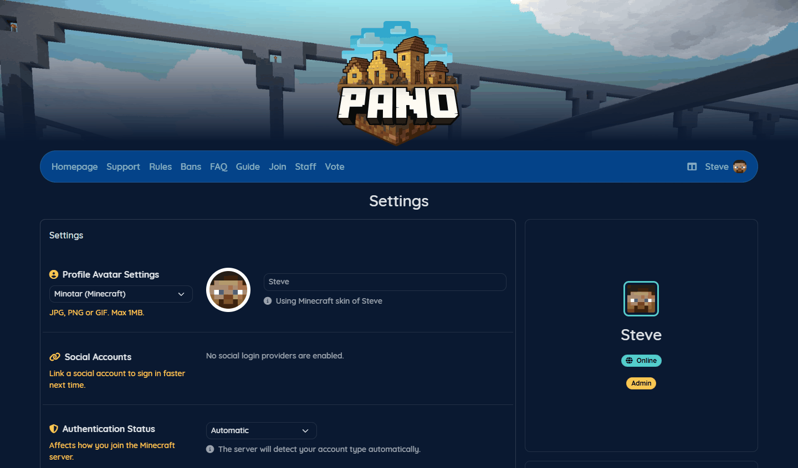
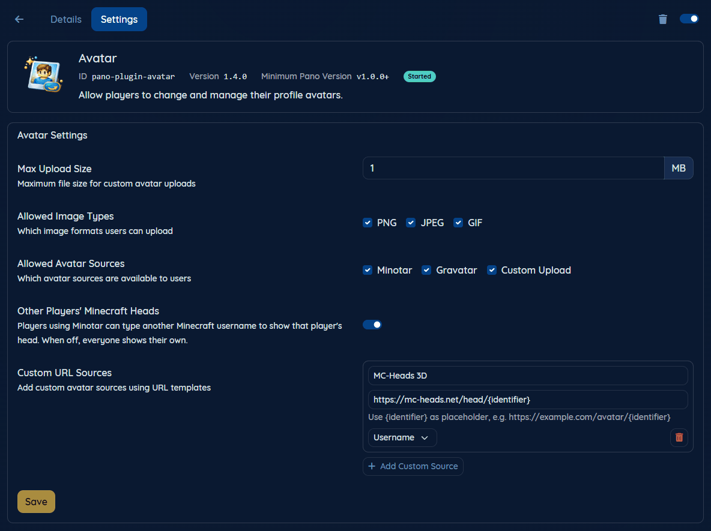

  
  <h1>Avatar</h1>
  
<b>Let every player show their face, from their Minecraft head to a custom picture.</b>

  

    
    
    
  

Avatar lets players choose how they look on your website. They can show their Minecraft head, use their Gravatar, or upload their own picture right from their settings page. You decide which options are allowed, and admins can change a player's avatar when needed.

<h3 align="center">Features</h3>

- 🧱 **Minecraft heads**: Players show their own in-game head with one click, no upload needed.
- 🖼️ **Custom uploads**: Players can upload their own PNG, JPEG or GIF picture.
- 🌐 **Gravatar support**: Players who already use Gravatar get their picture automatically.
- 🔗 **Extra avatar sources**: Add your own picture services, like 3D heads, with a simple link.
- 🎛️ **You set the rules**: Choose the allowed sources, file types and maximum upload size.
- 🛡️ **Fair play**: Decide if players may show another player's Minecraft head or only their own.
- 👮 **Admin control**: Admins can change any player's avatar from the panel.

<h3 align="center">Screenshots</h3>

<i>Choose the allowed sources, file types and upload size in the panel.</i>

<h3 align="center">Get started</h3>

1. Open your Pano panel and go to **Addons**.
2. Find **Avatar** and click **Install**.
3. Open your website's **Settings** page and pick your avatar under **Profile Avatar Settings**.

<h3 align="center">Support</h3>

Questions or ideas? Join our [Discord](https://panomc.com/discord) or visit [panomc.com](https://panomc.com).

<h3 align="center">License</h3>

Released under the MIT License.
